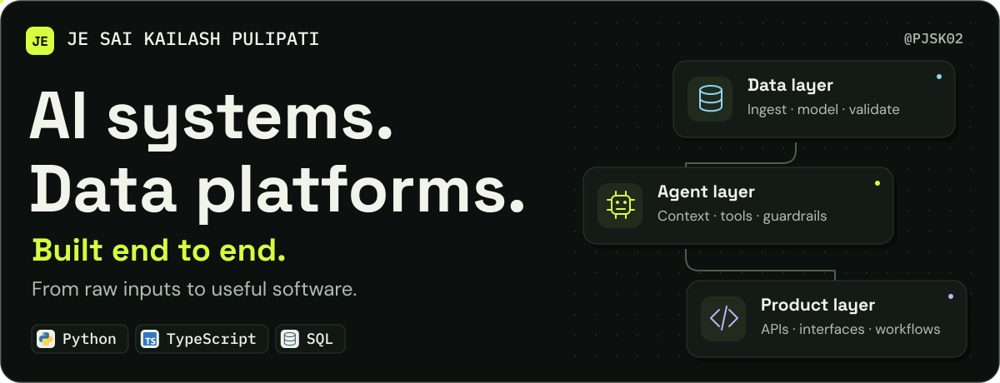
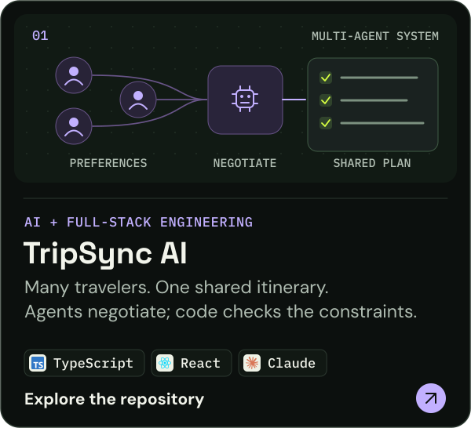
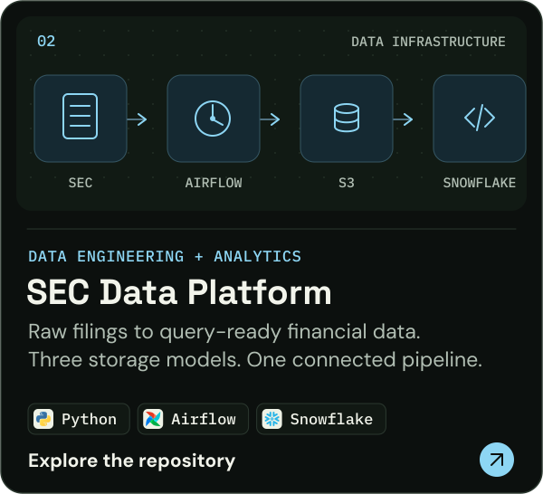
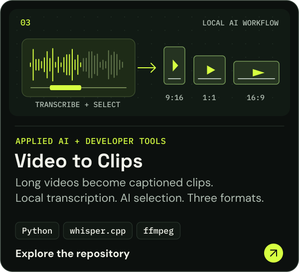
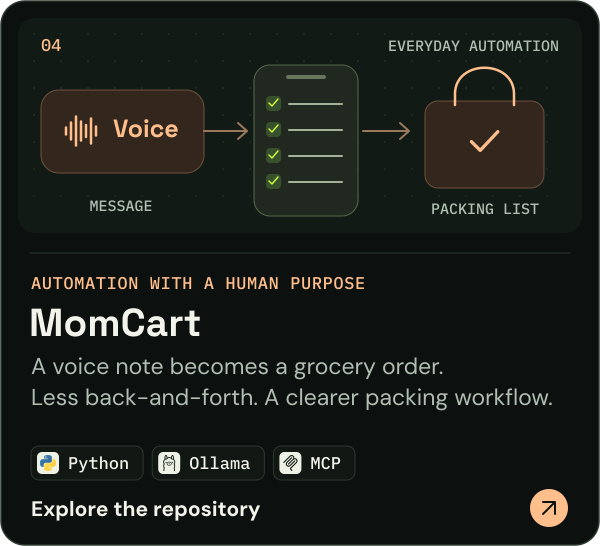
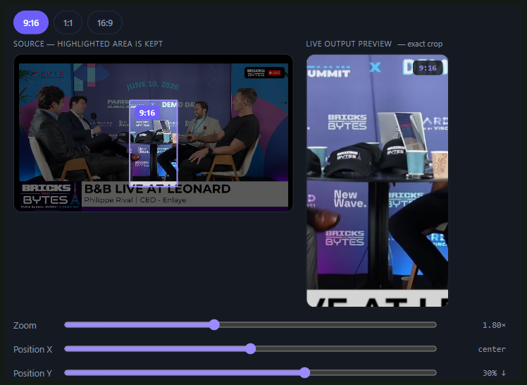
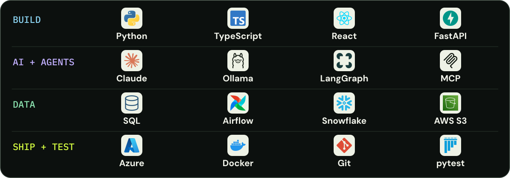
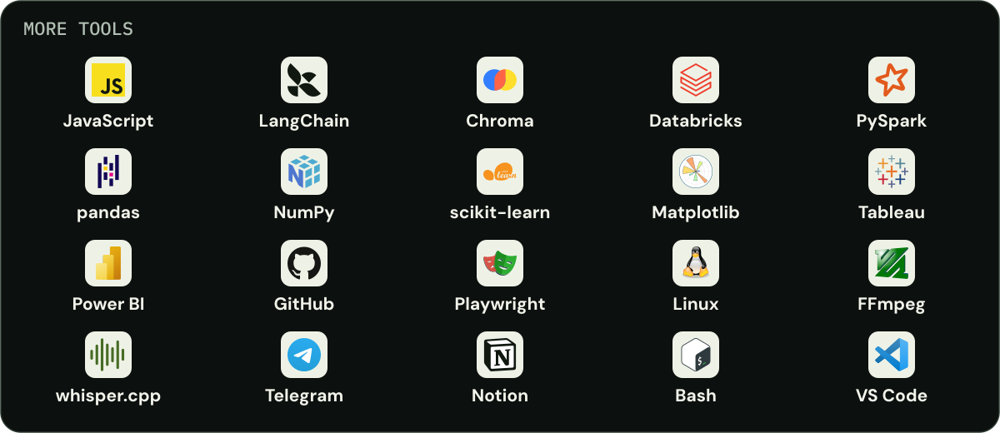

  <picture>
    <source media="(max-width: 640px)" srcset="assets/profile/hero-mobile.svg">
    
  </picture>

  
  &nbsp;
  
  &nbsp;
  

  I connect <strong>AI, data, and application development</strong> to solve practical problems. 
  Previously: <strong>Data Engineer · Boviet Solar</strong> &nbsp; / &nbsp; <strong>Data Analyst · Align Associates</strong>

## Selected builds

Agent orchestration, cloud data pipelines, media processing, and a grocery assistant built around a real everyday workflow.

  
  

  
  

  
<strong>Under the hood — architecture, tradeoffs, and code</strong>

| Project | What to look at |
| :--- | :--- |
| [TripSync AI](https://github.com/pjsk02/TripSync-AI#multi-agent-architecture) | Sequential agent orchestration, deterministic budget and schedule checks, and traceable decisions. |
| [SEC Data Platform](https://github.com/pjsk02/Automated-Multi-Stage-Data-Pipeline-Platform#architecture) | Raw, JSON, and denormalized storage models; S3 staging; Snowflake loading; API and analytics access. |
| [Video → Clips](https://github.com/pjsk02/Video-Transcription-and-Rendering-Pipeline#pipeline) | A shared web/CLI pipeline, file-backed jobs, validated selection, hardware-encoder fallback, and [tests](https://github.com/pjsk02/Video-Transcription-and-Rendering-Pipeline/tree/main/tests). Transcription is local; clip selection sends transcript text to Claude. |
| [MomCart](https://github.com/pjsk02/MomCart#how-it-works) | Structured item extraction, catalog matching, persistent carts, and packing updates through Notion MCP. |

## Inside the video pipeline

A real interface for reviewing how a source video will be cropped before rendering captioned clips.

   
  Crop editor · <a href="https://github.com/pjsk02/Video-Transcription-and-Rendering-Pipeline/blob/main/docs/quickcrop-modal.png">Screenshot from project documentation</a>

The web UI and CLI share the same pipeline. Clip selections are validated before rendering, and failed GPU encodes fall back to CPU processing.

[Explore the implementation](https://github.com/pjsk02/Video-Transcription-and-Rendering-Pipeline#tech-stack-and-architecture) · [Tests](https://github.com/pjsk02/Video-Transcription-and-Rendering-Pipeline/tree/main/tests) · [Benchmark procedure](https://github.com/pjsk02/Video-Transcription-and-Rendering-Pipeline/blob/main/BENCHMARKS.md)

## Core stack

<picture>
  <source media="(max-width: 640px)" srcset="assets/profile/toolkit-mobile.svg">
  
</picture>

  
<strong>More tools I work with</strong>

<picture>
  <source media="(max-width: 640px)" srcset="assets/profile/toolkit-more-mobile.svg">
  
</picture>

  
<strong>A little more about my background</strong>

My background includes data engineering at **Boviet Solar Technologies** and data analysis at **Align Associates**. My projects combine that data foundation with agent orchestration, full-stack development, and automation.

I care about the parts around the model call: the data flow, state, validation, interface, and what happens when something fails. I use tests, tracing, and architecture documentation to make those decisions easier to inspect.

[More experience and projects on my portfolio](https://je-sai-kailash-pulipati.framer.website).

[More projects and experience →](https://je-sai-kailash-pulipati.framer.website)
